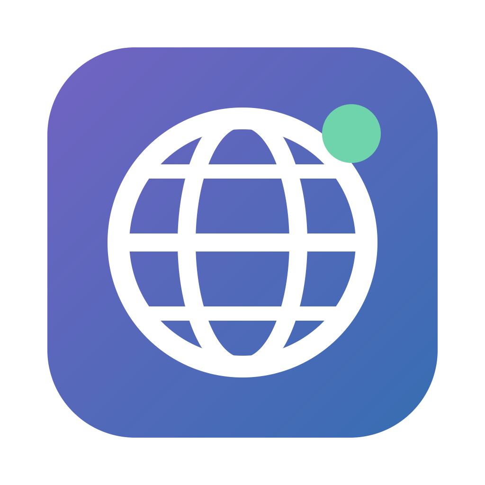

<p align="center"></p>

<h1 align="center">Pandemi Döneminde Dijital Diplomasi</h1>

<p align="center">Araştırma masası uygulaması · Windows ve macOS</p>

## İndir

| Bilgisayarınız | Dosya | Boyut |
|---|---|---|
| **Windows 10 / 11** | [Dijital-Diplomasi-Windows-Setup.exe](https://github.com/AstrocanX/dijital-diplomasi/releases/latest/download/Dijital-Diplomasi-Windows-Setup.exe) | 153 MB |
| **Mac, Apple Silicon** (M1, M2, M3, M4) | [Dijital-Diplomasi-Mac-Apple-Silicon.dmg](https://github.com/AstrocanX/dijital-diplomasi/releases/latest/download/Dijital-Diplomasi-Mac-Apple-Silicon.dmg) | 188 MB |
| **Mac, Intel işlemci** | [Dijital-Diplomasi-Mac-Intel.dmg](https://github.com/AstrocanX/dijital-diplomasi/releases/latest/download/Dijital-Diplomasi-Mac-Intel.dmg) | 195 MB |

Mac'inizin hangisi olduğunu bilmiyorsanız: Apple menüsü › **Bu Mac Hakkında**. "Çip: Apple M…" yazıyorsa Apple Silicon, "İşlemci: Intel" yazıyorsa Intel dosyasını indirin.

## Kurulum

### Windows

1. `Dijital-Diplomasi-Windows-Setup.exe` dosyasını çift tıklayın.
2. "Windows bilgisayarınızı korudu" uyarısı çıkarsa **Ek bilgi** › **Yine de çalıştır** seçin.
3. Kurulum birkaç saniyede biter ve uygulama açılır. Masaüstünde ve Başlat menüsünde kısayol oluşur.

### macOS

1. `.dmg` dosyasını açın ve uygulamayı **Uygulamalar** klasörüne sürükleyin.
2. İlk açılışta "doğrulanamadı" uyarısı çıkarsa uygulamaya **sağ tıklayın** › **Aç** › **Aç** seçin.
3. macOS 15 ve sonrasında: **Sistem Ayarları** › **Gizlilik ve Güvenlik** › en altta **Yine de Aç**.
4. Uyarı hâlâ çıkıyorsa Terminal'de şu komutu çalıştırın:

```bash
xattr -dr com.apple.quarantine "/Applications/Dijital Diplomasi.app"
```

Bu uyarılar uygulama ücretli Apple ve Microsoft geliştirici sertifikasıyla imzalanmadığı için çıkar. Dosyalar yalnızca bu sayfadan indirildiğinde güvenlidir.

## İlk açılış

- Tweet metinleri kurulum paketinin içindedir. İlk açılışta kendiliğinden yerleşir.
- Giriş için ekip yöneticisinin açtığı kullanıcı adı ve parola gerekir.
- Görseller ve videolar isteğe bağlıdır. Giriş yaptıktan sonra üst çubuktaki **↓ Medya** düğmesiyle indirilir: yaklaşık 7,8 GB, 8,5 GB boş alan gerekir. İndirme yarıda kalırsa kaldığı yerden sürer.
- Yeni sürümler uygulamanın içinden duyurulur.

## Sık sorulanlar

**Hesabım yok.** Ekip yöneticisinden hesap isteyin. Bu sayfada kayıt yoktur.

**Medya indirmesi başlamıyor.** Önce hesabınızla giriş yapın. Medya arşivi yalnızca ekip üyelerine açıktır.

**Araştırma kayıtlarım nerede?** Kendi bilgisayarınızda ve ekip sunucusunda. Bu depoda kaynak kod veya araştırma kaydı yoktur.

---

[Tüm sürümler](https://github.com/AstrocanX/dijital-diplomasi/releases)
